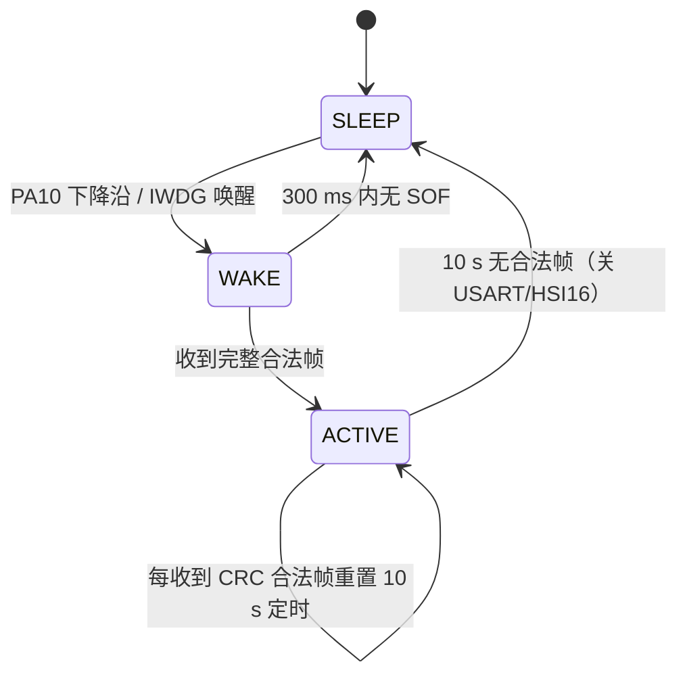
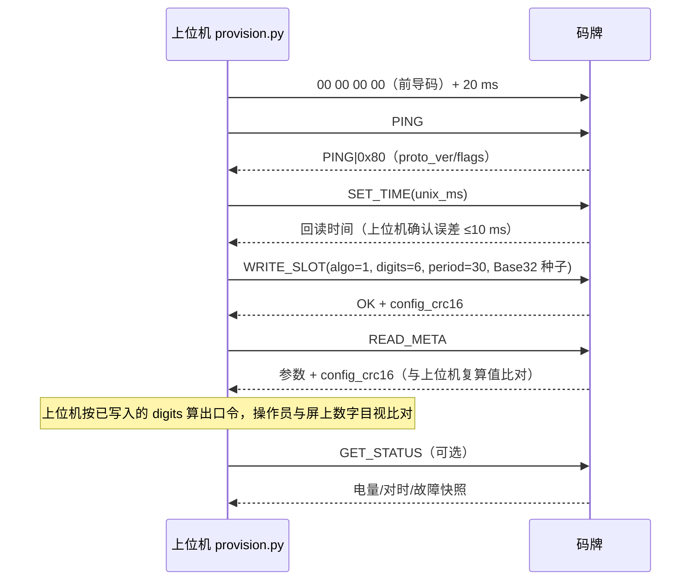

# 串口协议规范 v1.2

- 状态：**已定稿**（2026-10-02；v1.1 把对时改为 UTC 毫秒时间戳；
  v1.2 把 `WRITE_SLOT.digits` 从固定 6 放宽为 1..6）
- 物理层：3.5 mm 耳机口，UART（USART2，PA9/PA10），**115200 8N1**
- 前提：设备**无任何按键、非安全设备**，插上即信任（requirements.md §1/§5.2）
- 参考实现：`tools/provision/protocol.py`（帧与命令编解码）
- 测试向量：`tools/provision/test_protocol.py`，自检 `python3 -m unittest discover -s tools/provision -v`

> 本规范只解决四件事：**设备如何发现插头**（§3）、**字节怎么排**（§4）、
> **命令怎么用**（§5）、**配置正确如何确认**（§6）。其余（密钥安全、固件升级、
> 多槽位）明确不做（§9）。

## 1. 设计目标与约束

| 约束 | 协议后果 |
|------|----------|
| 无按键、无插头检测引脚 | 设备靠 RX 边沿唤醒 + 前导码发现上位机；会话闲置自动回睡（§3） |
| 必须确认配置结果 | 每条请求都必须有响应；写种子做内部读回 + 屏上码比对（§6） |
| 8 KB RAM / 32 KB Flash | 单帧上限 70 B，接收缓冲 96 B；CRC 用 16 项半字节表（32 B，§4.3） |
| 非安全设备 | 无鉴权、无加密、无防重放；CRC 只防误码，不防攻击（§9） |
| 耳机口插拔抖动、静电 | SOF + LEN 定界，CRC 错静默丢弃，扫 SOF 重同步（§4.4） |
| 上位机是唯一状态查看途径 | 保留 `GET_STATUS`，覆盖电量、对时、故障、复位原因（§5.5） |

## 2. 物理层与链路参数

### 2.1 电气连接（硬件既定，不可协商）

| CN1 触点 | 信号 | MCU 引脚 | 方向（相对设备） |
|----------|------|----------|------------------|
| TIP（pin 3） | UART_TX | PA9 | 设备 → 上位机 |
| RING1（pin 6） | UART_RX | PA10 | 上位机 → 设备 |
| SLEEVE（pin 5） | GND | GND | — |

- RING2（pin 4）与 SLEEVE 同接 GND，**TRS 与 TRRS 插头都能用**。
- PA9/PA10 为 5 V 容限，可直连 5 V 或 3.3 V 的 USB-TTL 适配器。
- **没有插头检测引脚**，插入只能由 RX 线上的活动推断（§3）。

### 2.2 链路参数

| 项 | 值 |
|----|----|
| 波特率 | **115200**，固定，不做自动波特率 |
| 帧格式 | 8N1，无流控 |
| 字节序 | 所有多字节字段**小端**（与 Cortex-M 一致） |
| 空闲电平 | 高（UART 标准） |
| 设备发送 | 仅回响应，**从不主动发帧** |
| 上行（设备休眠时） | PA10 = EXTI 下降沿 + 内部上拉；PA9 输出高，避免上位机 RX 悬空拾噪 |

### 2.3 为什么不用 LPUART1 / LSE（不改板）

115200 需要 HSI16 作为 USART 时钟；LPUART1 用 LSE（32.768 kHz）时波特率上限约
9600，无法承载本协议。因此 **v1 固定使用 USART2 + 唤醒时开 HSI16，不改板换脚**；
LPUART1 方案仅在将来硬件因其它需求改版时重新评估。

## 3. 插头发现与会话（RX 边沿唤醒）

### 3.1 设备侧链路状态机



- **SLEEP**：USART2 与 HSI16 关闭，PA10 配 EXTI 下降沿 + 上拉。
- **WAKE**：收到边沿后 ≤5 ms 内使能 HSI16 + USART2 接收，开 300 ms 窗口。
  窗口内没等到 SOF 就直接回 SLEEP —— 这同时兜住了插拔抖动与静电误唤醒。
- **ACTIVE**：解析帧、执行命令、回响应；每收到一个 CRC 合法帧，
  会话超时 `T_session = 10 s` 重新计时。
- 设备在 ACTIVE 期间才有较大电流（HSI16 + USART，数百 µA 量级），
  配置完成后自动回睡，不依赖上位机做任何"关闭"操作。
- IWDG 已启用并全程运行；超时先取 4 s 魔法数、待实测调整（architecture.md §7.3），
  不影响本协议。

> NOTE: 当前硬件批次没有插头检测引脚，插头发现只能靠 RX 边沿；将来硬件若增加
> 检测脚，可改用该脚唤醒并简化前导码流程，届时同步更新本节。

### 3.2 上位机唤醒前导（wake preamble）

设备可能在任意时刻处于 SLEEP，且被唤醒后 USART 需要几毫秒才就绪。
因此上位机在**每次新建会话**时按以下顺序发送：

```
[00 00 00 00]  +  ≥20 ms 静默  +  第一帧
  前导码 4 B
```

- 前导码用 `0x00` 而不是 `0xAA`：保证不落入 SOF 扫描逻辑。
- 前导码的第一个下降沿唤醒设备；20 ms 静默留足 USART 就绪时间（实际只需 <1 ms）。
- 随后发送 `PING`；若 300 ms 内无响应，可再发 `PING`（最多 3 次）。
- 3 次仍无响应：重新发前导码 + `PING`，最多 3 轮（覆盖错过首次唤醒的情况）。

### 3.3 会话规则

- `T_session = 10 s`：设备在最后一次收到 CRC 合法帧后开始计时，超时回 SLEEP。
- 上位机若距上次收发超过 **5 s**，发下一帧前必须重发前导码（保守值，留 2 倍余量）。
- 会话中任何一帧的响应超时（§7）都按"会话可能已死"处理：重发前导码 + `PING`。
- 设备重启（含 IWDG 复位）等同于会话中断，上位机按上述规则重连即可。

## 4. 帧格式

### 4.1 字节布局

```
偏移   字段      长度    说明
0      SOF       1      固定 0xAA
1      CMD       1      命令码；响应 = 请求码 | 0x80
2      SEQ       1      上位机分配，设备原样回显
3      LEN       1      PAYLOAD 长度，0..64
4      PAYLOAD   LEN    命令参数，见 §5
4+LEN  CRC_LO    1      CRC-16/CCITT-FALSE 低字节
5+LEN  CRC_HI    1      CRC 高字节
```

- 固定开销 6 B；最短 6 B，最长 **70 B**。
- **不设 EOF**：LEN 是唯一边界依据，PAYLOAD 因此可以包含任意字节（含 `0xAA`），
  也不需要转义。EOF 只会重复 CRC 已经提供的定界信息，反而增加解析歧义。

### 4.2 字段规则

- `CMD`：请求 0x01..0x7F；响应为请求码按位或 `0x80`（0x81..0xFF）。见 §5.1。
- `SEQ`：上位机自增（mod 256），重传保持同一 SEQ；设备只回显、不解释。
- `LEN`：仅计 PAYLOAD；本版上限 **64**，收到 >64 的帧回 `ERR_LEN`（§4.4）。
- 所有多字节字段小端。

### 4.3 CRC

**CRC-16/CCITT-FALSE**：`poly=0x1021, init=0xFFFF, refin=false, refout=false, xorout=0`。
覆盖范围是 **SOF 之后的全部帧字节**（CMD、SEQ、LEN、PAYLOAD），按字节顺序计算，
先发低字节、后发高字节。

校验值（用于自测）：`CRC("123456789") = 0x29B1`。

固件用 16 项半字节表即可，只占 32 B Flash：

```c
/* NOTE: 覆盖范围：SOF 之后、CRC 之前的全部字节；初值 0xFFFF。 */
static const uint16_t crc16_nibble[16] = {
    0x0000U, 0x1021U, 0x2042U, 0x3063U, 0x4084U, 0x50A5U, 0x60C6U, 0x70E7U,
    0x8108U, 0x9129U, 0xA14AU, 0xB16BU, 0xC18CU, 0xD1ADU, 0xE1CEU, 0xF1EFU,
};

static uint16_t crc16_update(uint16_t crc, uint8_t byte)
{
    crc ^= (uint16_t)byte << 8;
    crc = (uint16_t)((crc << 4) ^ crc16_nibble[crc >> 12]);
    crc = (uint16_t)((crc << 4) ^ crc16_nibble[crc >> 12]);
    return crc;
}
```

### 4.4 解析、丢帧与重同步

| 情况 | 设备动作 |
|------|----------|
| CRC 错 | **静默丢弃，不回 NACK**。CMD/SEQ 不可信，回包只会在噪声下形成乒乓；由上位机超时重传覆盖 |
| `LEN > 64` | 仍按 LEN 收完 PAYLOAD + CRC；CRC 正确则回单字节 `ERR_LEN`，否则静默丢弃 |
| `CMD` 未知（含误收到响应码） | 回 `ERR_UNKNOWN_CMD` |
| 自 SOF 起 100 ms 未收完整帧 | 丢弃残帧，进入重同步 |
| 任何丢弃后 | 从下一个 `0xAA` 重新开始解析 |

以上规则要求接收端只保留 96 B 缓冲（70 B 最长帧 + 余量），RAM 代价可忽略。

### 4.5 响应规则

- 每条请求**恰好收到一条响应**；设备响应延迟上限见 §7。
- 响应 `CMD = 请求 CMD | 0x80`，`SEQ` 原样回显，`LEN ≥ 1`。
- `PAYLOAD[0]` 是状态码：`0x00` = OK，其余见 §5.9。错误响应只含状态字节。
- 上位机按 `(CMD|0x80, SEQ)` 匹配响应；不匹配的帧丢弃并继续等待。
- **同一时刻只允许一个未决请求**（不做流水线），设备实现因此无需并发状态。
- 所有命令天然幂等：重传不会造成额外副作用（`WRITE_SLOT` 对相同配置跳过实际写入），
  因此协议**不需要去重表**，也无需保存上一次响应。

## 5. 命令集

### 5.1 命令总表

| CMD | 名称 | 方向 | 请求 LEN | 响应 LEN（含状态字节） | 说明 |
|-----|------|------|----------|------------------------|------|
| 0x01 | `PING` | ↔ | 0 | 11 | 连通性与版本握手 |
| 0x02 | `GET_TIME` | ↔ | 0 | 10 | 读 RTC 时间（UTC 毫秒）与可信标志 |
| 0x03 | `SET_TIME` | → | 8 | 9 | 对时（UTC 毫秒时间戳） |
| 0x04 | `GET_STATUS` | ↔ | 0 | 11 | 读设备状态全量快照 |
| 0x05 | `WRITE_SLOT` | → | 6..61 | 3 | 写种子与 TOTP 参数 |
| 0x06 | `READ_META` | ↔ | 0 | 9 | 读配置元信息与配置 CRC |
| 0x07 | `ERASE_SLOT` | → | 0 | 1 | 删除种子 |
| 0x08 | `SET_CALIB` | → | 2 | 3 | 写 RTC 校准 |

> 0x09..0x7F 保留；0x80..0xFF 仅作响应码，设备收到时回 `ERR_UNKNOWN_CMD`。

### 5.2 PING（0x01）

请求：无载荷。

响应数据（状态字节之后）：

| 偏移 | 字段 | 类型 | 说明 |
|------|------|------|------|
| 0 | `proto_ver` | u8 | 本协议版本 = `0x01` |
| 1 | `fw_ver` | u16 | 固件版本，`major<<8 | minor` |
| 3 | `max_payload` | u8 | 本设备允许的最大 PAYLOAD = `0x40` |
| 4 | `flags` | u16 | 设备状态位，见 §5.10 |
| 6 | `uptime_s` | u32 | 上电以来秒数（RTC 不可用时为近似值） |

上位机应检查 `proto_ver == 1` 且 `max_payload ≥ 61`（56 字符种子的最长载荷），
否则拒绝继续。

### 5.3 GET_TIME（0x02）

请求：无载荷。

响应数据：

| 偏移 | 字段 | 类型 | 说明 |
|------|------|------|------|
| 0 | `unix_ms` | u64 | 当前 UTC Unix 时间（毫秒） |
| 8 | `time_flags` | u8 | bit0 `TRUSTED`；bit1 `NEVER_SET`；bit2 `STALE` |

`unix_ms` 是绝对 UTC 时间戳。设备内部 RTC 的亚秒粒度为 1/256 s（≈3.9 ms），
回读值可能比写入值小最多 4 ms。TOTP 计算用 `unix_ms / 1000` 取整秒。

### 5.4 SET_TIME（0x03）

请求载荷：

| 偏移 | 字段 | 类型 | 说明 |
|------|------|------|------|
| 0 | `unix_ms` | u64 | 上位机在**发送帧之前**采样的 UTC Unix 毫秒时间戳 |

响应数据：设备写完后回读的 `unix_ms`（字段同 GET_TIME）。
上位机检查 `|回读值 − 发送值| ≤ 10 ms`；超过 10 ms 视为失败，重做对时。

**对时精度分析（不需要往返测延迟）：**

- 帧传输时间 < 2 ms，设备在收帧结束处写 RTC，单向误差 < 10 ms；
- 设备把毫秒时间戳折算到"秒 + 1/256 s 亚秒寄存器"，量化误差 ≤ 1/256 s ≈ 3.9 ms；
- 对 30 s 的 TOTP 窗口，±1 s 已足够，本方案余量有 100 倍以上；
- 因此**不做** PING 测 RTT 的补偿流程，协议保持单次写、单次回读。

设备动作：写 RTC、置 `TRUSTED`、清 `NEVER_SET`/`STALE`，并记录"上次对时时刻"
（存 RTC 备份寄存器，掉电即失，与 RTC 本身的命运一致）。

`STALE` 阈值（DOT2 提醒策略）属固件策略，暂定 30 天，不在协议内协商。

### 5.5 GET_STATUS（0x04）

请求：无载荷。

响应数据：

| 偏移 | 字段 | 类型 | 说明 |
|------|------|------|------|
| 0 | `flags` | u16 | 见 §5.10 |
| 2 | `reset_cause` | u8 | 0=POR/BOR，1=IWDG，2=软件复位，3=其它，4=未知 |
| 3 | `battery_mv` | u16 | 滤波后的 VDD 毫伏（未知为 0） |
| 5 | `battery_level` | u8 | 0=未知，1=正常，2=低电，3=极低 |
| 6 | `last_set_age_s` | u32 | 距上次对时的秒数；从未对时为 `0xFFFFFFFF` |

### 5.6 WRITE_SLOT（0x05）

请求载荷：

| 偏移 | 字段 | 类型 | 约束 |
|------|------|------|------|
| 0 | `algo` | u8 | 只能是 1 = HMAC-SHA1；其它值回 `ERR_UNSUPPORTED` |
| 1 | `digits` | u8 | 1..6（本设备是 6 位段码屏）；否则 `ERR_PARAM` |
| 2 | `period` | u16 | 15..300 秒，典型 30；否则 `ERR_PARAM` |
| 4 | `secret_len` | u8 | Base32 字符数，1..56 |
| 5 | `secret` | bytes | Base32 字符，A-Z 与 2-7，**无填充、无小写、无空格** |

- 56 个 Base32 字符最多解出 35 字节种子；载荷最大 61 B，不超单帧 64 B 上限。
- `digits` 决定口令位数：口令按 `digits` 位计算并左补 0 至 `digits` 位
  （如 digits=4 时为 `0042`）。屏显示时**右对齐**，不足 6 位的高位数字位留空；
  不得为了填满 6 位而补零扩展，否则操作员读到的位数与 App 输入不符。
- 设备侧流程：校验 → Base32 解码 → 写 EEPROM → **读回逐字节比对** →
  比对通过才回 OK；任何一步失败回 `ERR_PARAM`/`ERR_EEPROM`，且不得留下半份配置。
- 若 EEPROM 中已有完全相同的配置，跳过物理写入直接回 OK（重传不增加擦写磨损）。
- 响应数据：`config_crc16`（u16，定义见 §5.7）。上位机可用它确认写入的就是发出去的内容。

### 5.7 READ_META（0x06）

请求：无载荷。

响应数据：

| 偏移 | 字段 | 类型 | 说明 |
|------|------|------|------|
| 0 | `flags` | u8 | bit0 已写入种子；bit1 记录校验通过 |
| 1 | `algo` | u8 | 同 WRITE_SLOT |
| 2 | `digits` | u8 | 同 WRITE_SLOT |
| 3 | `period` | u16 | 同 WRITE_SLOT |
| 5 | `secret_len` | u8 | 同 WRITE_SLOT |
| 6 | `config_crc16` | u16 | 配置 CRC，定义见下 |

未写入种子时：`flags=0`，其余字段全 0，状态仍为 OK（空配置是正常状态，不是错误）。

`config_crc16` 定义（上位机用同一条种子即可复算）：

```
CRC-16/CCITT-FALSE( algo || digits || period_le || secret_len || secret_ascii )
```

**任何命令都不回显种子，`READ_META` 也不含种子**：种子非敏感（§9），
不提供读出接口只是为了避免"配置工具变成种子读取器"这一多余功能。

### 5.8 ERASE_SLOT（0x07）与 SET_CALIB（0x08）

**ERASE_SLOT**：请求无载荷；设备使配置记录失效并读回确认，响应只有状态字节。
成功后再 `READ_META` 应看到 `flags=0`。

**SET_CALIB**：请求 `cal_centi_ppm`（i16，小端，单位 0.01 ppm，范围 ±30000，
即 ±300 ppm，0 = 关闭校准）。设备把它折算到 RTC 校准寄存器最接近的档位
（LSE 平滑校准步进约 0.954 ppm），响应回读实际生效的 `applied_centi_ppm`（i16）。

### 5.9 状态码

| 值 | 名称 | 含义 |
|----|------|------|
| 0x00 | `OK` | 成功 |
| 0x01 | `ERR_LEN` | 载荷长度与命令不符，或 LEN > 64 |
| 0x02 | — | **保留**：本地 CRC 校验失败，设备静默丢弃、从不发送 |
| 0x03 | `ERR_UNKNOWN_CMD` | 未知命令码 |
| 0x04 | `ERR_PARAM` | 字段非法（算法/位数/周期/Base32/校准范围等） |
| 0x05 | `ERR_STATE` | 当前状态不允许该命令（保留，暂不产生） |
| 0x06 | `ERR_EEPROM` | 写入或读回比对失败 |
| 0x07 | `ERR_BUSY` | 内部操作进行中，稍后重试（保留，暂不产生） |
| 0x08 | `ERR_UNSUPPORTED` | 参数合法但本固件不支持（如 algo=2） |
| 0xFF | `ERR_INTERNAL` | 未预期的内部错误 |
| 0x09..0x7E | — | 保留 |

上位机对未知状态码必须按失败处理并打印原始值。

### 5.10 `flags` 位定义（PING 与 GET_STATUS 共用）

| 位 | 名称 | 含义 | 对应显示 |
|----|------|------|----------|
| 0 | `SEED_PRESENT` | 已写入有效的点位配置 | DOT1 灭 |
| 1 | `RTC_NEVER_SET` | 上电后从未对时 | DOT2 亮 |
| 2 | `RTC_STALE` | 距上次对时超过阈值（暂定 30 天） | DOT2 亮 |
| 3 | `LOW_BATTERY` | 低电量 | DOT4 亮 |
| 4 | `CRITICAL_BATTERY` | 极低电量 | DOT4 亮 |
| 5 | `FAULT_LATCHED` | 故障锁存（含 IWDG 复位、自检失败） | DOT5 亮 |
| 6 | `CALIB_ACTIVE` | RTC 校准已启用 | — |
| 7 | `IWDG_ENABLED` | 看门狗已启用 | — |
| 8..15 | — | 保留，必须为 0 | — |

## 6. 一次完整配置的流程



1. **PING**：确认设备在线、协议版本兼容、`SEED_PRESENT` 等基线状态。
2. **SET_TIME**：发送前立即取 UTC 毫秒时间；用响应回读确认（差值 >10 ms 视为失败，重做）。
3. **WRITE_SLOT**：校验用自己的 Base32 复算 `config_crc16`，与响应比对。
4. **READ_META**：再次比对 `config_crc16` 与参数，确认落盘内容。
5. **屏上码比对**：上位机按同一 CPU 时间、种子与 READ_META 回读的 `digits`
   算出口令并显示剩余秒数，操作员与设备屏上数字比对（高位留空不计）；
   一致即配置完成，无需专用确认命令。
6. **GET_STATUS**：记录电量与对时状态，作为活动前检查单的一部分。

时间与种子顺序可以互换（两者互不依赖），推荐按上表执行。

## 7. 时序与重传

| 参数 | 值 | 说明 |
|------|----|------|
| `T_wake` | 300 ms | 唤醒后等待 SOF 的窗口；到期无 SOF 即回睡 |
| `T_frame_rx` | 100 ms | 自 SOF 起未收完整帧则丢弃重同步 |
| `T_session` | 10 s | 最后一个合法帧后的会话保持时间 |
| 设备响应期限（非存储命令） | ≤100 ms | PING/GET_*/SET_TIME/READ_META |
| 设备响应期限（存储命令） | ≤200 ms | WRITE_SLOT/ERASE_SLOT/SET_CALIB（含 EEPROM 读回） |
| 上位机响应超时 | 300 ms / 500 ms | 分别对应非存储 / 存储命令 |
| 重传 | 3 次 | 相同 SEQ；全部失败则重发前导码 + PING |

EEPROM 写周期在 STM32L0 上为毫秒级（字级擦/写各典型 3.3 ms）；keystore 记录固定
52 B = 13 字，最坏 26 次字操作 ≈ 90 ms，仍在存储命令 200 ms 响应期限内。

## 8. 测试向量

以下字节由 `tools/provision/protocol.py` 生成，并由 `test_protocol.py` 固化校验；
任何实现都必须逐字节一致（`crc` 为小端）。

| 场景 | 帧字节（hex） |
|------|---------------|
| CRC 自测 `"123456789"` | `0x29B1` |
| `PING` 请求，SEQ=0 | `aa 01 00 00 ac fb` |
| `PING` 响应，SEQ=0，proto=1，fw=0x0001，max=64，flags=0，uptime=0 | `aa 81 00 0b 00 01 00 01 40 00 00 00 00 00 00 38 6e` |
| `SET_TIME` 请求，SEQ=0x2A，`2026-10-02T00:00:00Z`=1790899200000 ms | `aa 03 2a 08 00 20 e9 f9 a0 01 00 00 86 cf` |
| `SET_TIME` 响应，SEQ=0x2A，状态 OK，回读同一时间 | `aa 83 2a 09 00 00 20 e9 f9 a0 01 00 00 ce 41` |
| `GET_STATUS` 响应，SEQ=0x2B，flags=0，reset=POR，2900 mV，level=1，从未对时 | `aa 84 2b 0b 00 00 00 00 54 0b 01 ff ff ff ff 7c 2f` |
| `WRITE_SLOT` 请求，SEQ=1，种子 `JBSWY3DPEHPK3PXP`，period=30 | `aa 05 01 15 01 06 1e 00 10 4a 42 53 57 59 33 44 50 45 48 50 4b 33 50 58 50 b0 97` |
| `WRITE_SLOT` 请求，SEQ=3，种子 `JBSWY3DPEHPK3PXP`，digits=4，period=30 | `aa 05 03 15 01 04 1e 00 10 4a 42 53 57 59 33 44 50 45 48 50 4b 33 50 58 50 c0 36` |
| `READ_META` 响应，SEQ=2，已写入上述配置 | `aa 86 02 09 00 03 01 06 1e 00 10 38 b6 9e 9e` |
| `ERASE_SLOT` 响应，SEQ=9，EEPROM 失败 | `aa 87 09 01 06 b3 c5` |

示例配置（digits=6）的 `config_crc16 = 0xB638`；digits=4 的同种子配置为 `0xDD5E`。

## 9. 明确不做

- **不做鉴权/加密/防重放**：插上即信任，任何人接线都能改配置（requirements.md §5.2）。
- **不提供种子读出命令**：种子虽非敏感，也不把配置工具做成读取器。
- **不做设备主动上报、不做事件流**：设备只在被请求时应答，保持"从不主动发帧"。
- **不做固件升级通道**：固件只能经 SWD 烧录（FR-5）。
- **不做多槽位/切换**：单点位单码（FR-6）。
- **不做流控与自动波特率**：固定 115200 8N1。

## 10. 后续实现

协议定稿后按 architecture.md §3/§10 落地：

1. 固件 `drivers/uart_link.{h,c}`（字节收发 + 帧收发 + 超时）与
   `drivers/plug_detect.{h,c}`（EXTI 唤醒 + 唤醒窗口）——**已实现**：
   USART2 硬件层为 `drivers/usart2_hw.{h,c}`，帧/会话逻辑含主机侧测试；
2. 固件 `app/proto.{h,c}`（命令分派 + 校验 + 与 keystore/clock_rtc 对接）；
3. 上位机 `tools/provision/provision.py`（本规范 §6 的 CLI：ping/set-time/
   write-seed/read-meta/erase/status/verify），依赖 `pyserial`，参考编解码已就绪。
