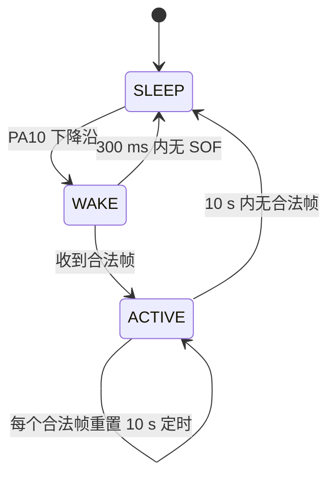

# 耳机口串口协议

本文描述设备的配置串口协议。活动前，上位机用这套协议对时、写种子、读状态。
物理层是 3.5 mm 耳机口上的 UART（Universal Asynchronous Receiver/Transmitter，通用异步收发器）。

- 线协议版本为 1，由 PING 响应的 `proto_ver` 字段报告。
- 参考实现：`../../provision/protocol.py`（编解码）与 `../../provision/session.py`（会话）。
- 固件实现：`firmware/src/drivers/uart_link.*`（链路层）与 `firmware/src/app/proto.*`（命令层）。
- 设计前提：设备无按键，也不是安全设备。协议没有鉴权、加密与防重放，CRC 只防误码。

## 1 物理层

| 耳机插头 | 信号 | 方向（相对设备） |
|----------|------|------------------|
| TIP | UART_TX | 设备 → 上位机 |
| RING1 | UART_RX | 上位机 → 设备 |
| SLEEVE | GND | — |

- 波特率固定为 38400，帧格式 8N1，无流控。
- RING2 与 SLEEVE 同接 GND，TRS 与 TRRS 插头都能用。
- TX/RX 引脚为 5 V 容限，可直连 5 V 或 3.3 V 的 USB-TTL 适配器。
- 设备只回响应，从不主动发送。
- 字节可以连续发送，不必留间隔。设备用中断收字节，缓冲 96 B（约 25 ms 线上时间）。
- 多字节字段一律小端，与 Cortex-M 一致。
- 本版耳机口没有电气保护器件。

## 2 帧格式

一帧由 7 个部分组成，总长 = 4 + LEN + 2 字节：

| 字段 | 长度 | 说明 |
|------|------|------|
| SOF | 1 B | 固定 `0xAA` |
| CMD | 1 B | 命令码 |
| SEQ | 1 B | 序号，设备原样回显 |
| LEN | 1 B | PAYLOAD 字节数 |
| PAYLOAD | LEN B | 命令载荷 |
| CRC_LO | 1 B | 帧校验低字节 |
| CRC_HI | 1 B | 帧校验高字节 |

帧校验使用 CRC-16/CCITT-FALSE：多项式 `0x1021`，初值 `0xFFFF`，不反转，异或输出 `0`。
校验覆盖 CMD、SEQ、LEN 与 PAYLOAD，不覆盖 SOF。
校验值在线上先发低字节。
参考值：`CRC-16/CCITT-FALSE("123456789") = 0x29B1`。

### 2.1 请求与响应

响应帧复用请求的 CMD 与 SEQ，规则如下：

- 响应 CMD = 请求 CMD | `0x80`。
- SEQ 原样回显。
- PAYLOAD 的第一个字节是状态码；其后是响应数据，可以为空。

错误响应只含状态码，不含数据。

### 2.2 异常帧处理

| 情况 | 设备行为 |
|------|----------|
| SOF 错位或 CRC 不符 | 静默丢弃，不回包 |
| 帧未收完且超过 100 ms | 丢弃残帧，重新等待 SOF |
| CRC 合法但 LEN > 64 | 回 ERR_LEN，并计入会话活动 |
| 命令码未知 | 回 ERR_UNKNOWN_CMD |

PAYLOAD 上限为 64 B。LEN 字段可达 255，设备接收超长帧只做计数，不回传载荷。
解析器从每个 `0xAA` 重新同步，因此前导噪声不会吞掉后续的合法帧。

### 2.3 并发模型

设备同一时刻只处理一个请求。上位机必须收到响应后再发下一帧，不使用流水线。

## 3 插头发现与会话

设备没有插头检测引脚，靠 RX 线上的下降沿推断会话开始。
链路有三个状态：



- SLEEP：USART 与 HSI16 关闭，RX 引脚上拉，等待下降沿。
- WAKE：收到边沿后打开 USART，等待 SOF，窗口 300 ms。
- ACTIVE：解析命令并回响应；距最后一个合法帧超过 10 s 即回 SLEEP。

设备侧时限：

| 名称 | 值 | 含义 |
|------|----|------|
| `T_wake` | 300 ms | 唤醒后等待 SOF 的窗口 |
| `T_frame_rx` | 100 ms | 自 SOF 起收完整帧的期限 |
| `T_session` | 10 s | 最后一个合法帧之后的会话保持时间 |

### 3.1 上位机流程

1. 发送 4 B 前导码 `00 00 00 00`。
2. 静默至少 20 ms，参考实现取 25 ms。
3. 发送 PING，超时 300 ms；每轮最多 3 次，最多 3 轮。
4. 握手成功后直接发命令；空闲超过 5 s 时重新发前导码。
5. 普通命令超时 300 ms，存储命令超时 500 ms，各自重传 3 次。
6. 连续失败时重新握手，再试 3 次；仍失败则报告设备无响应。

存储命令指 WRITE_SLOT、ERASE_SLOT 与 SET_CALIB，设备侧最坏耗时低于 100 ms。

### 3.2 序号与重传

- 上位机为每个新命令分配 SEQ，每次加 1，超过 255 后回绕。
- 重传必须沿用同一个 SEQ。
- 上位机按 `CMD | 0x80` 与 SEQ 匹配响应，忽略不匹配的帧。
- 设备不缓存已执行的命令；重传会再次执行命令。
- 所有命令都可安全重发：WRITE_SLOT 遇到相同记录会跳过擦写。

会话结束时设备自动回睡，上位机不需要发送关闭命令，拔下插头即可。

## 4 命令一览

| 命令 | 码 | 请求载荷 | 成功响应数据 | 用途 |
|------|----|----------|--------------|------|
| PING | `0x01` | 无 | 10 B | 握手与版本核对 |
| GET_TIME | `0x02` | 无 | 9 B | 读时间与可信标志 |
| SET_TIME | `0x03` | 8 B | 8 B | 对时 |
| GET_STATUS | `0x04` | 无 | 10 B | 读状态快照 |
| WRITE_SLOT | `0x05` | 5 + N B | 2 B | 写入点位配置 |
| READ_META | `0x06` | 无 | 8 B | 读配置元信息 |
| ERASE_SLOT | `0x07` | 无 | 无 | 删除点位配置 |
| SET_CALIB | `0x08` | 2 B | 2 B | 写 RTC 校准值 |
| GET_CW（可选扩展） | `0x09` | 无 | 本设备返回 ERR_UNSUPPORTED | 读取 CW 播放参数 |
| SET_CW（可选扩展） | `0x0A` | 3 B | 本设备返回 ERR_UNSUPPORTED | 保存 CW 播放参数 |

对已知命令，除 WRITE_SLOT 之外，请求载荷长度必须精确匹配；否则设备回 ERR_LEN。

## 5 命令详解

### 5.1 PING（0x01）

请求无载荷。响应数据 10 B：

| 偏移 | 长度 | 字段 | 说明 |
|------|------|------|------|
| 0 | 1 | proto_ver | 线协议版本，当前为 1 |
| 1 | 2 | fw_version | 固件版本，`major << 8 \| minor`；`0x0100` 表示 1.0 |
| 3 | 1 | max_payload | 设备允许的最大 PAYLOAD，当前为 64 |
| 4 | 2 | flags | 设备状态位，见 §7.1 |
| 6 | 4 | uptime_s | 上电或上次对时以来的秒数 |

上位机应检查两项：`proto_ver == 1`，且 `max_payload ≥ 61`。
最长种子（56 字符）的 WRITE_SLOT 载荷为 61 B，低于该值就无法配置。

### 5.2 GET_TIME（0x02）

请求无载荷。响应数据 9 B：

| 偏移 | 长度 | 字段 | 说明 |
|------|------|------|------|
| 0 | 8 | unix_ms | 当前 UTC Unix 毫秒 |
| 8 | 1 | flags | 时间标志，见 §7.2 |

RTC 不可用或读取失败时，`unix_ms` 为 0，`flags` 为 NEVER_SET 或 STALE。

### 5.3 SET_TIME（0x03）

请求数据 8 B：`unix_ms`，UTC Unix 毫秒，小端 u64。
响应数据 8 B：`readback_ms`，设备回读的毫秒值。

设备把亚秒量化到 1/256 s，量化误差最大 3.9 ms。
回读值与发送值的差还包含链路时延，实机实测在数十毫秒以内。
上位机应把两者比较，容差取 ±100 ms，这对 30 s 的 TOTP 窗口仍有充足余量。
参考实现在每次重试前重新采样时间，最多尝试 3 次。

时间戳必须落在 2000-01-01T00:00:00Z 到 2099-12-31T23:59:59Z 之间。
超出范围回 ERR_PARAM；RTC 未就绪回 ERR_INTERNAL。

对时成功后，设备立即刷新显示、清除故障锁存，并把 `uptime_s` 的基准改为对时时刻。

### 5.4 GET_STATUS（0x04）

请求无载荷。响应数据 10 B：

| 偏移 | 长度 | 字段 | 说明 |
|------|------|------|------|
| 0 | 2 | flags | 设备状态位，见 §7.1 |
| 2 | 1 | reset_cause | 复位原因，见 §7.3 |
| 3 | 2 | battery_mv | 滤波后的电池电压，毫伏；0 表示未知 |
| 5 | 1 | battery_level | 0 未知、1 正常、2 低电、3 极低 |
| 6 | 4 | last_set_age_s | 距上次对时的秒数；`0xFFFFFFFF` 表示从未对时 |

设备每 10 分钟采样一次电量，每次取 8 个样本做平均。
低电阈值默认为 2.4 V，极低阈值默认为 2.2 V，两者都需要按实测标定。

### 5.5 WRITE_SLOT（0x05）

请求载荷：

| 偏移 | 长度 | 字段 | 说明 |
|------|------|------|------|
| 0 | 1 | algo | 1 = HMAC-SHA1；其他值回 ERR_UNSUPPORTED |
| 1 | 1 | digits | 口令位数，1–6 |
| 2 | 2 | period_s | 步长，15–300 秒 |
| 4 | 1 | secret_chars N | Base32 字符数，1–56 |
| 5 | N | secret | Base32 文本，仅 A-Z 与 2-7 |

约束与行为：

- LEN 必须等于 5 + N，且总长在 6–61 B 之间；否则回 ERR_LEN。
- 种子必须是大写、无填充的规范 Base32，末尾残留位必须为 0。
- 小写、空白、`=` 与非规范尾部位一律拒绝，回 ERR_PARAM。
- 解码后的种子必须为 1–35 字节，否则回 ERR_PARAM。
- 写入流程为擦除、写入、逐字节读回；任一步失败回 ERR_EEPROM，且不留半份配置。
- 新记录与现有记录完全一致时，设备跳过物理写入，重传不产生磨损。

响应数据 2 B：`config_crc16`，小端 u16。
该值等于 CRC-16/CCITT-FALSE(请求 PAYLOAD 的前 5 + N 字节)，即 algo、digits、period、secret_chars 与 secret 文本。
示例：种子 `JBSWY3DPEHPK3PXP`、algo = 1、digits = 6、period = 30 s，`config_crc16 = 0xB638`。

注意：`config_crc16` 是配置指纹，与帧尾 CRC 不是一回事。帧尾 CRC 覆盖 CMD 到 PAYLOAD 的全部字节。

写种子成功后，设备重新加载配置、刷新显示并清除故障锁存。

### 5.6 READ_META（0x06）

请求无载荷。响应数据 8 B：

| 偏移 | 长度 | 字段 | 说明 |
|------|------|------|------|
| 0 | 1 | flags | bit0 已写种子，bit1 记录有效；无记录时为 0 |
| 1 | 1 | algo | 算法编号 |
| 2 | 1 | digits | 口令位数 |
| 3 | 2 | period_s | 步长，秒 |
| 5 | 1 | secret_chars | Base32 字符数，不是解码字节数 |
| 6 | 2 | config_crc16 | 配置指纹 |

设备没有读出种子的命令，READ_META 只返回元信息。
记录无效或未写入时，响应数据全部为 0。

### 5.7 ERASE_SLOT（0x07）

请求无载荷，成功响应无数据。
记录本来为空时同样返回 OK，且不产生擦写。
EEPROM 擦除失败时回 ERR_EEPROM。

### 5.8 SET_CALIB（0x08）

请求数据 2 B：`centi_ppm`，小端 i16，单位 0.01 ppm。
取值范围 ±30000，即 ±300 ppm；0 表示关闭校准。

响应数据 2 B：`applied`，设备从校准寄存器回读并折算出的实际值。
请求值可能无法被硬件精确表达，回读值才是真实生效值。

长度不等于 2 回 ERR_LEN；超出范围回 ERR_PARAM；RTC 未就绪或写失败回 ERR_INTERNAL。
设备状态位 CALIB_ACTIVE 表示校准已启用。

### 5.9 可选 CW 扩展（0x09 / 0x0A）

GET_CW 无请求载荷；SET_CW 请求为 `u8 wpm, u16 tone_hz`，多字节字段小端。数显设备没有 CW 播放功能，对正确长度的这两个命令返回 `ERR_UNSUPPORTED`，长度不符返回 `ERR_LEN`，不修改种子、RTC 或存储。普通 `setup` 不发送本扩展，不要求设置 WPM 或 TONE。支持该扩展的 UV-K5 未配置时使用原值 8 WPM、700 Hz；完整字段、范围及兼容语义见 [可选 CW 播放配置扩展](../../provision/docs/cw-protocol.md)。

## 6 状态码

响应 PAYLOAD 的第一个字节是状态码：

| 值 | 名称 | 含义 |
|----|------|------|
| `0x00` | OK | 成功 |
| `0x01` | ERR_LEN | 载荷长度非法，含设备自动应答的 LEN > 64 |
| `0x02` | — | 保留：本地 CRC 失败，设备静默丢弃，从不应答 |
| `0x03` | ERR_UNKNOWN_CMD | 命令码未知 |
| `0x04` | ERR_PARAM | 字段越界或种子非法 |
| `0x05` | ERR_STATE | 保留，当前不产生 |
| `0x06` | ERR_EEPROM | EEPROM 写入、擦除或读回失败 |
| `0x07` | ERR_BUSY | 保留，当前不产生 |
| `0x08` | ERR_UNSUPPORTED | 算法或功能不支持 |
| `0xFF` | ERR_INTERNAL | 内部错误，例如 RTC 未就绪 |

## 7 标志位与枚举

### 7.1 设备状态位

PING 与 GET_STATUS 的 `flags` 共用同一组位定义：

| 位 | 名称 | 含义 |
|----|------|------|
| 0 | SEED_PRESENT | 已写入有效种子 |
| 1 | RTC_NEVER_SET | 本电池周期内从未对时 |
| 2 | RTC_STALE | 距上次对时超过 30 天 |
| 3 | LOW_BATTERY | 低电量 |
| 4 | CRITICAL_BATTERY | 极低电量 |
| 5 | FAULT_LATCHED | 故障锁存，含看门狗复位 |
| 6 | CALIB_ACTIVE | RTC 校准已启用 |
| 7 | IWDG_ENABLED | 独立看门狗已启用 |

### 7.2 时间标志

GET_TIME 响应的 `flags` 每次返回下列之一：

| 值 | 名称 | 含义 |
|----|------|------|
| 1 | TRUSTED | 已对时且未超期，时间可信 |
| 2 | NEVER_SET | 从未对时 |
| 4 | STALE | 距上次对时超过 30 天，或 RTC 读取失败 |

### 7.3 复位原因

GET_STATUS 的 `reset_cause` 取值：

| 值 | 含义 |
|----|------|
| 0 | 上电复位或欠压复位 |
| 1 | 看门狗复位 |
| 2 | 软件复位 |
| 3 | 其它复位 |
| 4 | 未知 |

### 7.4 电量档位

| 值 | 名称 | 阈值（默认值） |
|----|------|----------------|
| 0 | 未知 | 采样失败或尚未初始化 |
| 1 | 正常 | 不低于 2.4 V |
| 2 | 低电 | 低于 2.4 V，且不低于 2.2 V |
| 3 | 极低 | 低于 2.2 V |

## 8 配置确认流程

参考工具按以下步骤完成一次配置，每一步都要核对：

1. PING：核对 `proto_ver == 1`，且 `max_payload ≥ 61`。
2. WRITE_SLOT：核对响应中的 `config_crc16` 与上位机复算值一致。
3. READ_META：核对标志位、算法、位数、周期、字符数与 `config_crc16`。
4. SET_TIME：发送当前 UTC 毫秒，回读误差在 ±100 ms 以内。
5. 状态回读：上位机用 GET_STATUS 记录最终设备状态。

`setup` 子命令执行以上全流程。WRITE_SLOT 响应、READ_META 字段和配置 CRC、SET_TIME 响应及 GET_STATUS 均由工具检查，不需要人工听码或对屏幕读数。
不指定种子时，参考工具生成 20 字节（160 bit）随机种子，并在写入前打印一次供登记。

## 9 测试向量

以下字节流由 `../../provision/test_protocol.py` 固定，改动协议时必须同步更新。

PING 请求，SEQ = 0：

```
aa 01 00 00 ac fb
```

PING 响应，SEQ = 0，flags = 0，uptime = 0：

```
aa 81 00 0b 00 01 00 01 40 00 00 00 00 00 00 38 6e
```

SET_TIME 请求，SEQ = 0x2A，时间 2026-10-02T00:00:00Z（1790899200000 ms）：

```
aa 03 2a 08 00 20 e9 f9 a0 01 00 00 86 cf
```

WRITE_SLOT 请求，SEQ = 1，种子 JBSWY3DPEHPK3PXP，6 位，30 s：

```
aa 05 01 15 01 06 1e 00 10 4a 42 53 57 59 33 44 50 45 48 50 4b 33 50 58 50 b0 97
```

READ_META 响应，SEQ = 2，`config_crc16 = 0xB638`：

```
aa 86 02 09 00 03 01 06 1e 00 10 38 b6 9e 9e
```

ERASE_SLOT 失败响应，SEQ = 9，ERR_EEPROM：

```
aa 87 09 01 06 b3 c5
```

## 10 互操作要求与边界

- 严格一问一答：收到响应后再发下一帧。
- 响应匹配依据 `CMD | 0x80` 与 SEQ；不匹配的帧直接忽略。
- 重传可能让设备重复执行命令；所有命令都可安全重发。
- 设备从休眠唤醒后必须先收前导码；上位机不需要发送关闭命令。
- CRC 只防误码，不防攻击。协议没有鉴权、加密与防重放。
- 任何能接触耳机口的人都能读写配置，种子以明文存入 EEPROM。
- 协议不提供种子读出、固件升级、多槽位与密钥协商。
